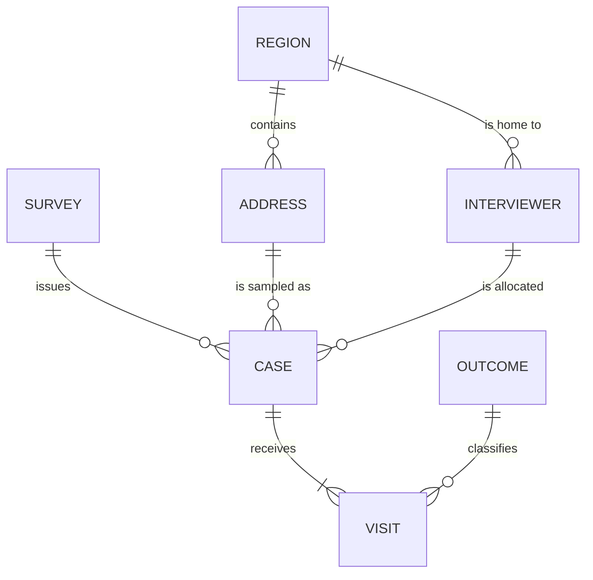
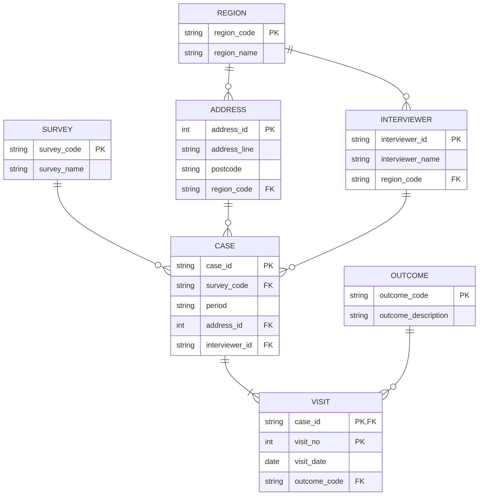

# Reference model: session 11

The diagrams use Mermaid, which renders on GitHub, GitLab and in VS Code.

## Conceptual model



Key insight: **`CASE` is the link between SURVEY, ADDRESS and PERIOD.** Without it, survey ↔ address is a many-to-many relationship with nowhere to hang the interviewer or the visits.

## Logical model (3NF)



## Physical model and proof (stretch)

```bash
python solutions/load_and_check.py
```

`schema.sql` creates the 7 tables. The script loads them from the flat file (52 visits → 24 cases, 24 addresses, 4 interviewers, 5 outcomes, 2 surveys, 2 regions) and confirms that **rebuilding the flat view with joins gives exactly the original rows**, so normalising is lossless. It then answers "final outcome per case" with a simple query.

## Discussion answers
- **Case ≠ address.** The same address can be a case for two surveys, or for the same survey in two periods. Mixing them up is the classic grain mistake (session 04).
- **Visit key:** `(case_id, visit_no)`. A visit has no identity outside its case, so it's a *weak entity*.
- **Two different regions:** `interviewer.region_code` is the interviewer's *home* region, and `address.region_code` is where the address is. They're **separate relationships**. Covering another region is fine *because* we didn't derive one from the other. A model that stored only the interviewer's region would put cases in the wrong region.
- **Not in the data:** the visit limit (a business rule, so a check rather than a column), interviewer name history (needs effective dates if it matters, see SCDs in session 12), and the survey's sampling design.

## Normalisation walkthrough

| Step | Problem in the flat file | Fix |
|---|---|---|
| 1NF | Already atomic: one value per cell, no repeating columns | – |
| 2NF | With key `(case_id, visit_no)`, columns like `survey_name` and `interviewer_name` depend on `case_id` **only** (partial dependency) | Move case-level columns to `CASE` |
| 3NF | `survey_name` depends on `survey_code`, `region_name` on `region_code`, `interviewer_name` on `interviewer_id`, `outcome_description` on `outcome_code` (transitive dependencies) | Move each to its own table |

Results: an interviewer's name change is **one** update, outcome descriptions can't drift, and the model's structure matches the business.
